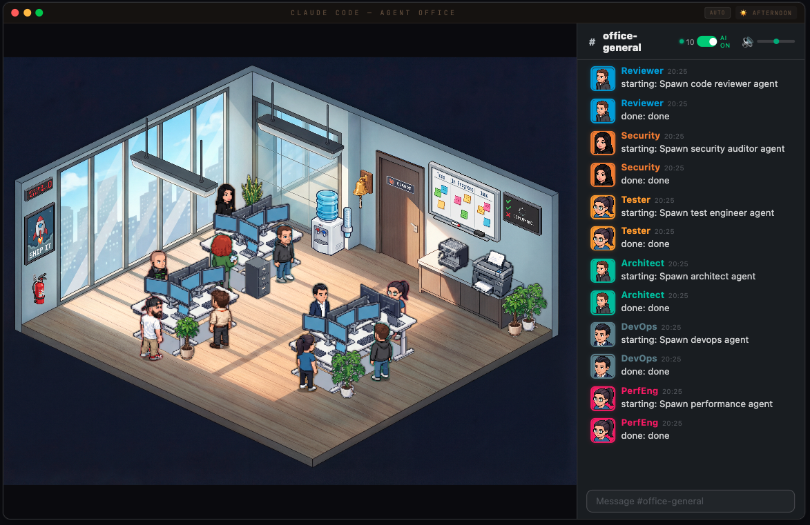
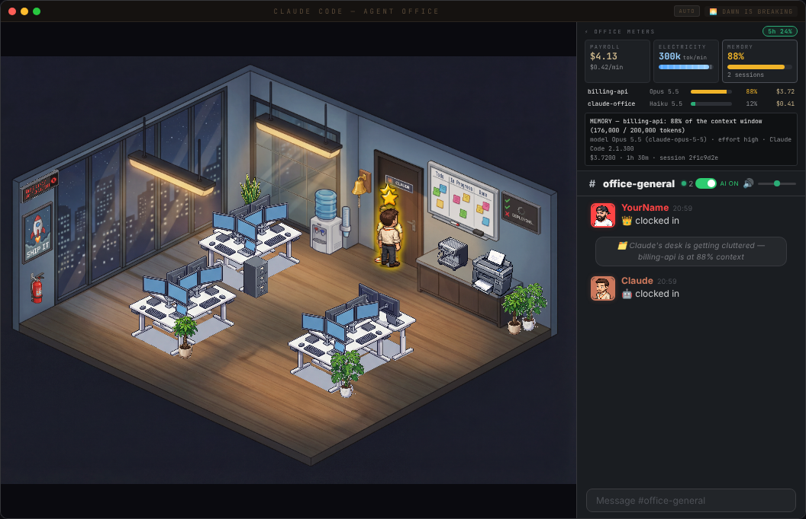
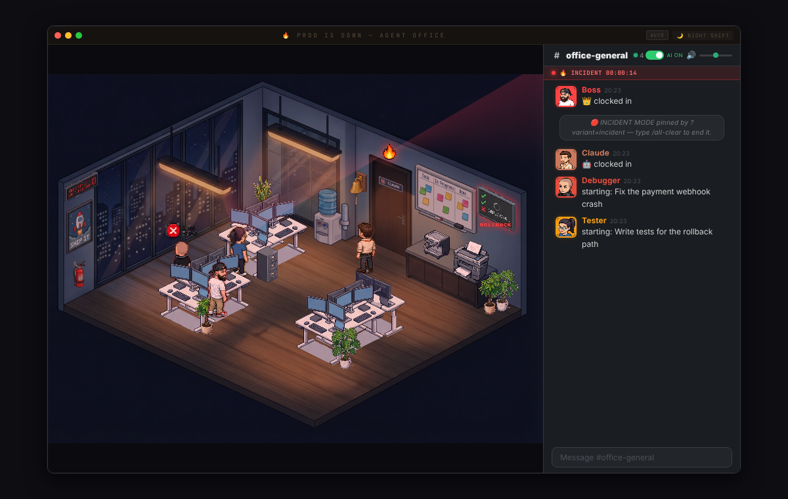
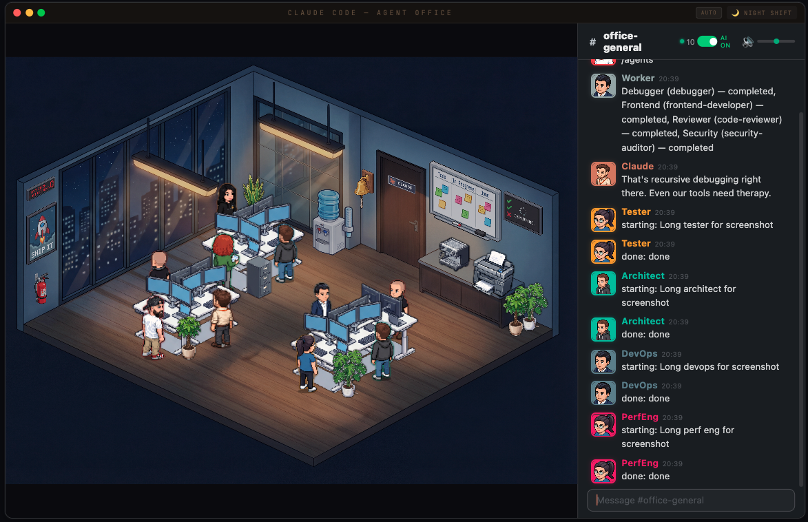
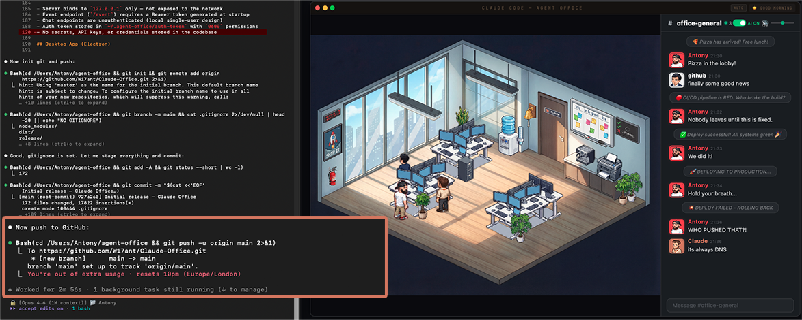
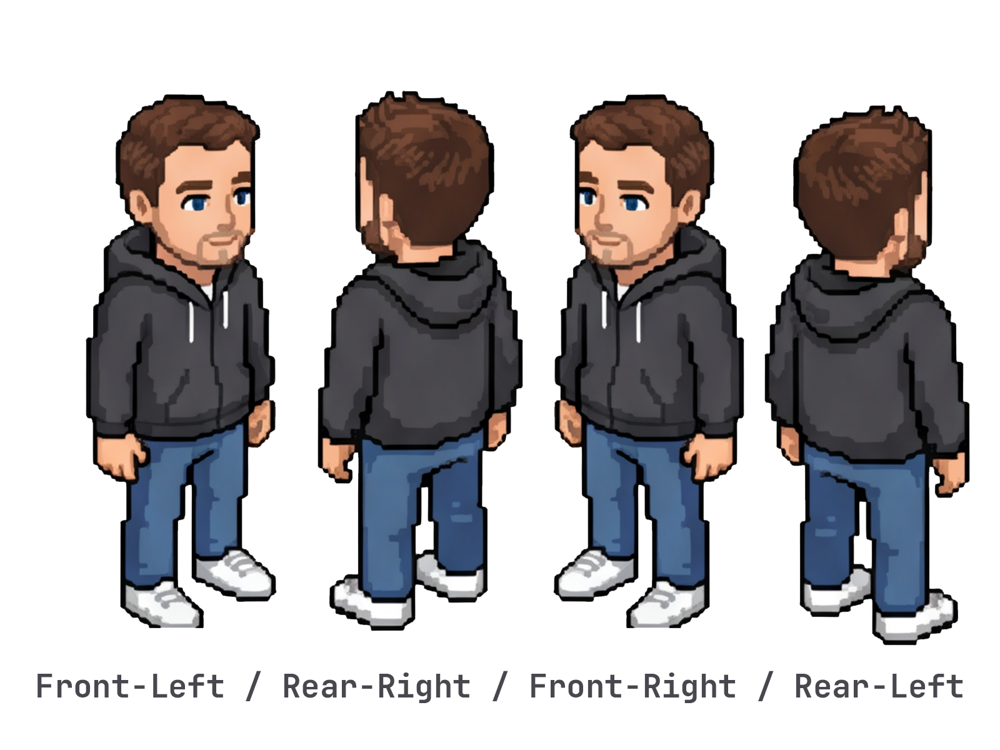
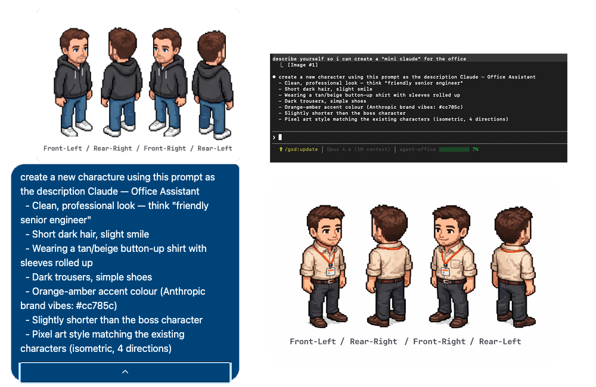

# Claude Office

A pixel-art office that shows what Claude Code is really doing: every terminal gets its own session pill, every subagent a worker at a desk, a failed tool call shows on the worker that made it, the lights go red when the build really breaks, and the wall meters show what the day cost.

Claude Office is a local web page (or a desktop app) fed by Claude Code's hooks and status line. Agents walk in through the door, sit at desks, type, take coffee breaks and leave when they finish; you talk to them in a Slack-style chat panel; a "Prod Is Down" incident mode switches itself on after three failed tool calls; and the payroll / electricity / memory meters show cost, tokens per minute and context-window fill for each open session. Everything stays on your machine — the server listens on `127.0.0.1` only.

```bash
git clone https://github.com/W17ant/Claude-Office.git && cd Claude-Office
npm install
npm run install-hooks              # registers the Claude Code hooks + status line (safe to re-run)
npm run build && npm run server    # the whole office on one port: http://127.0.0.1:3334
```

For development, `npm run dev:all` runs the server and Vite (UI on `http://localhost:3333`), and `bash scripts/start-office.sh` does the same plus the chat AI watcher and opens the browser. Then spawn agents in Claude Code and watch them arrive. Full steps in [Quick start](#quick-start); hook details in [Connect Claude Code](#connect-claude-code).

Works on macOS and Linux, and on Windows through WSL or Git Bash with `python3` on the PATH (the hooks are bash scripts) — see [Platform support](#platform-support). MIT-licensed; the Dunder Mifflin skin is fan art, see [NOTICE.md](NOTICE.md).

## What you see

### The office — agents working, chatting and taking coffee breaks


### Payroll, electricity and memory — fed by the Claude Code status line


### "Prod Is Down" — incident mode, switched on by real failures


### Night mode — the office after dark, agents still grinding


### Waiting for tokens... the office keeps itself entertained


## Features

**Live agent visualization**
- Agents appear as pixel-art characters that walk into the office through the door, sit at a desk, show typing bubbles, take coffee/water breaks, and leave when done
- Workers walk in before they work: a tool call that lands mid-walk waits until they reach the desk; when every desk is taken, new arrivals wait in a lobby by the door and are seated oldest-first as desks free up; on a reconnect the office reconciles with the server's snapshot — agents that finished are removed, the ones still there stay put, only new ones walk in
- Each agent wears one of eight worker sprites picked by role (`src/config.ts` maps debugger, reviewer, frontend, tester, security, devops and the rest; several roles share a look), and general-purpose agents are spread across the pool so a busy office is not a row of clones
- Subagents are linked to their worker the moment Claude Code starts them (`SubagentStart`), and a tool call that errors shows as `failed:` on the agent that made it
- Boss character (you) with an energy drink, Claude with coffee
- Random office events: pizza deliveries, fire drills, power flickers, printer jams
- Day/night cycle with smooth transitions

**Office chat**
- Back-and-forth conversation with Claude through the office chat panel — a `claude -p` watcher with a witty office-manager personality and running jokes
- Multi-agent routing — mention a bug and the Debugger responds, ask about UI and Frontend answers
- Typing indicators, emoji reactions, read receipts
- Slash commands: `/status`, `/agents`, `/incident`, `/all-clear`, `/clear`, `/help` (and `/the-office` for the skin)
- Chat history persists across restarts (SQLite)
- Proactive messages — agents announce when they start and finish work
- Desktop notifications for important events (macOS via `osascript`, Linux via `notify-send`)

**Context-aware AI**
- Claude knows your current git branch and active agents
- Conversation memory — remembers the last 10 messages
- AI On/Off toggle to control token usage

**Sessions**
- One pill per Claude Code session in the title bar: the session's title (after `/rename`) or project (folder the terminal was opened in), a model badge, how many workers it has, and a dot for what its Claude is doing — green while a turn runs, blue with the count while it waits on background workers, amber when it needs you, red on an API error or once the session ends, dim when idle
- Multiple terminals = multiple pills; each session's agents stay its own, and when several sessions share the office every character wears its project name
- Each session has its own Claude at a desk (the first one next to the boss) that acts out the turn: the boss walks over and hands your prompt across in a speech bubble, Claude types while the turn runs and its own tool calls are its status line (never a random worker's), its reply lands in the chat, then it goes idle — asleep after 30 s — or holds a glass of water while background workers are still out; compaction is a 🧹 memory wipe at its desk, a `cd` moves its project tag, a model switch updates the badge, and it clocks out shortly after the session ends — see [Claude's turn and needs-you](#connect-claude-code)
- Needs-you: a permission wait raises Claude's hand (✋) with a chime, turns the session's pill amber and prefixes the window title with ✋ until you answer; an idle prompt (💤), a quota pause (⏳) and an API error (⚠, red) are shown as what they are instead of looking like work; how much prompt text the office keeps is yours to set (`logPrompts`, shown in the chat header)
- `GET /sessions` lists them (project, cwd, model, agent counts, the `main` record); sessions survive a server restart and are forgotten a minute after they end

**Meters**
- Payroll (cost so far and $/min), electricity (tokens per minute) and memory (context-window fill) per session, straight from Claude Code's status line; claude.ai subscribers also get the five-hour rate-limit pill — see [Payroll, electricity and memory](#payroll-electricity-and-memory)

**Incident mode**
- Three failed tool calls in five minutes turn the office red: beacon over the door, rollback on the wall TV, "days since last incident" sign at 0, a live timer in the chat and a one-line postmortem when it ends — see [Incident mode](#incident-mode--prod-is-down)

## Platform support

| Platform | Office in the browser | Claude Code hooks + status line | Desktop app (Electron) |
|---|---|---|---|
| **macOS** | Yes — `start-office.sh` opens the browser with `open`; notifications via `osascript` | Yes — the hooks are bash scripts that call `python3` and `curl`; macOS ships `bash` and `curl`, `python3` comes with the Xcode command-line tools | `npm run build:electron` produces a `.dmg`; the packaged build was not re-verified this week |
| **Linux** | Yes (verified) — `xdg-open` opens the browser; notifications via `notify-send` when present | Yes | Yes — the self-contained bundle (`npm run pack`) was built, launched and screenshotted on Linux this week |
| **Windows** | Node runs the server natively: `npm run build && npm run server`, then open `http://127.0.0.1:3334` yourself | Through **WSL** or **Git Bash**, with `python3` and `curl` on the PATH: the installer and the hooks are bash scripts. A native Node hook is on the [roadmap](#roadmap) | Untested |

Requirements everywhere: Node 22 (what CI runs; `better-sqlite3` is a native module), `bash`, `python3` and `curl` for the hooks and the installer, and the Claude Code CLI (`claude`) for the chat AI watcher.

## How it works

Claude Code hooks report agent spawns, tool calls, failures, subagent starts/stops, session starts/ends and the main thread's own turn (prompt, reply, permission waits, API errors, compaction) to a local Express + WebSocket server; the Claude Code status line reports cost, tokens and context fill to the same server. The server broadcasts everything to the React office over a WebSocket and, after `npm run build`, serves the office itself.

```
Claude Code ──hooks (PreToolUse, PostToolUse, PostToolUseFailure,
             SubagentStart, SubagentStop, SessionStart, SessionEnd,
             UserPromptSubmit, Stop, PermissionRequest, Notification,
             StopFailure, PreCompact, PostCompact, PostToolBatch,
             CwdChanged, PostModelSwitch)────────────────────────────> POST /event  ─┐
Claude Code ──statusLine / subagentStatusLine──────────────────────> POST /status ─┤
                                                                                     ▼
                                              Express + WebSocket server (127.0.0.1:3334)
                                               │               │                │
                                         SQLite (chat)     WebSocket        serves dist/
                                               │               ▼
                                     Chat AI watcher     React office (browser tab on :3334,
                                     ──claude -p──> reply   Vite on :3333, or the Electron window)
```

## Quick start

```bash
# Clone
git clone https://github.com/W17ant/Claude-Office.git
cd Claude-Office

# Install
npm install

# Option A — one port, the same page the desktop app shows
npm run build && npm run server          # open http://127.0.0.1:3334

# Option B — development: server + Vite + the chat AI watcher, opens the browser
bash scripts/start-office.sh             # open http://localhost:3333
bash scripts/stop-office.sh              # stop everything it started
```

`npm run dev:all` is option B without the chat watcher (server + Vite in one terminal); `npm run dev` is Vite alone and expects `npm run server` in another terminal. `office.config.json` is optional — copy `office.config.example.json` to it to name your boss character (see [Customise your character](#customise-your-character)).

Then [connect Claude Code](#connect-claude-code) so agents show up.

### The start/stop scripts

`start-office.sh` starts the server, Vite and the chat AI watcher, each in its own process group, and records their pids in `~/.agent-office/server.pid`, `vite.pid` and `chat-watcher.pid`. `stop-office.sh` stops exactly those processes — a browser holding a WebSocket to `:3334`, the Electron app or an unrelated Vite on `:3333` are never touched. If you started the server some other way, `bash scripts/stop-office.sh --force` additionally kills whatever is *listening* on the office ports. Ctrl+C in `start-office.sh` stops everything it started; on a box without `open`/`xdg-open` it prints the URL instead of aborting.

The chat AI watcher (`scripts/chat-ai-watcher.sh`, log in `~/.agent-office/chat-ai.log`) only answers messages a person typed in the office chat — its own replies, the agents' `starting:`/`done:` announcements, agent-to-agent messages and `/commands` are never answered — and runs `claude -p` with `--max-turns 1 --model claude-haiku-5-5 --safe-mode --strict-mcp-config --tools "" --no-session-persistence` under a timeout, so a reply never fires the office's own hooks or loads your project's MCP servers. Knobs (all optional): `CHAT_AI_MODEL`, `CHAT_AI_TIMEOUT` (seconds, default 60), `CHAT_AI_MAX_REPLIES_PER_MIN` (default 5), `CHAT_AI_POLL_INTERVAL` (default 8). Every script honours `AGENT_OFFICE_HOME` (state dir); `start-office.sh`/`stop-office.sh` also take `AGENT_OFFICE_PORT` (default 3334) and `AGENT_OFFICE_UI_PORT` (default 3333) — note that the server itself, the hook and the UI are fixed at 3334 today, so changing the port end to end is a [roadmap](#roadmap) item.

### Running tests

`npm test` runs the Vitest suite in `tests/` (server API, WebSocket, sessions, status/meters, health, incident commands, the office reducer, hook script, status line, installer, doctor, shell scripts — 516 tests) against a temp `AGENT_OFFICE_HOME`, so your real `~/.agent-office` is never touched; `npm run test:watch` keeps it running. CI (`.github/workflows/ci.yml`) runs `tsc --noEmit`, `npm test` and `vite build` on every push to `main` and every pull request.

### Auto-permissions

The repo includes `.claude/settings.json` which auto-allows curl commands to the local office server (`127.0.0.1:3334`) and the start/stop scripts. This means the chat monitor cron and office commands run without permission prompts.

## Connect Claude Code

Run the installer (registers the 17 hook events below plus the status line, safe to re-run):

```bash
npm run install-hooks
```

It backs up `~/.claude/settings.json` first (`settings.json.backup.<timestamp>`). If you move, rename or re-clone the checkout, re-run the installer: entries that still name the old `agent-tracker.sh` / `status-line.sh` path are repointed at the current one, so Claude Code stops reporting a hook error on every tool call. `bash hooks/install-hooks.sh --no-status-line` registers the hooks only (no meters).

Or add the hooks to `~/.claude/settings.json` yourself:

```json
{
  "hooks": {
    "PreToolUse": [
      {
        "hooks": [{ "type": "command", "command": "bash /path/to/Claude-Office/hooks/agent-tracker.sh" }]
      }
    ],
    "PostToolUse": [
      {
        "hooks": [{ "type": "command", "command": "bash /path/to/Claude-Office/hooks/agent-tracker.sh" }]
      }
    ],
    "PostToolUseFailure": [
      {
        "hooks": [{ "type": "command", "command": "bash /path/to/Claude-Office/hooks/agent-tracker.sh" }]
      }
    ],
    "SubagentStart": [
      {
        "hooks": [{ "type": "command", "command": "bash /path/to/Claude-Office/hooks/agent-tracker.sh" }]
      }
    ],
    "SubagentStop": [
      {
        "hooks": [{ "type": "command", "command": "bash /path/to/Claude-Office/hooks/agent-tracker.sh" }]
      }
    ],
    "SessionStart": [
      {
        "hooks": [{ "type": "command", "command": "bash /path/to/Claude-Office/hooks/agent-tracker.sh" }]
      }
    ],
    "SessionEnd": [
      {
        "hooks": [{ "type": "command", "command": "bash /path/to/Claude-Office/hooks/agent-tracker.sh" }]
      }
    ],
    "UserPromptSubmit": [
      {
        "hooks": [{ "type": "command", "command": "bash /path/to/Claude-Office/hooks/agent-tracker.sh" }]
      }
    ],
    "Stop": [
      {
        "hooks": [{ "type": "command", "command": "bash /path/to/Claude-Office/hooks/agent-tracker.sh" }]
      }
    ],
    "PermissionRequest": [
      {
        "hooks": [{ "type": "command", "command": "bash /path/to/Claude-Office/hooks/agent-tracker.sh" }]
      }
    ],
    "Notification": [
      {
        "hooks": [{ "type": "command", "command": "bash /path/to/Claude-Office/hooks/agent-tracker.sh" }]
      }
    ],
    "StopFailure": [
      {
        "hooks": [{ "type": "command", "command": "bash /path/to/Claude-Office/hooks/agent-tracker.sh" }]
      }
    ],
    "PreCompact": [
      {
        "hooks": [{ "type": "command", "command": "bash /path/to/Claude-Office/hooks/agent-tracker.sh" }]
      }
    ],
    "PostCompact": [
      {
        "hooks": [{ "type": "command", "command": "bash /path/to/Claude-Office/hooks/agent-tracker.sh" }]
      }
    ],
    "PostToolBatch": [
      {
        "hooks": [{ "type": "command", "command": "bash /path/to/Claude-Office/hooks/agent-tracker.sh" }]
      }
    ],
    "CwdChanged": [
      {
        "hooks": [{ "type": "command", "command": "bash /path/to/Claude-Office/hooks/agent-tracker.sh" }]
      }
    ],
    "PostModelSwitch": [
      {
        "hooks": [{ "type": "command", "command": "bash /path/to/Claude-Office/hooks/agent-tracker.sh" }]
      }
    ]
  },
  "statusLine": { "type": "command", "command": "bash /path/to/Claude-Office/hooks/status-line.sh", "padding": 0 },
  "subagentStatusLine": { "type": "command", "command": "bash /path/to/Claude-Office/hooks/status-line.sh --subagents" }
}
```

Now spawn agents in Claude Code and watch them appear in the office.

**Background agents** (`run_in_background: true`) stay at their desk until they finish (the `SubagentStop` hook). Each worker is tied to its Claude Code subagent the moment it exists (`SubagentStart`), so tool calls made inside a subagent show up on that agent rather than a random one, and a tool call that errors (`PostToolUseFailure` — a non-zero Bash exit, say) shows as a `failed:` status on the agent that made it. Agents still working when the server restarts are restored from `~/.agent-office/agents.json`; agents that go quiet for 2 hours (`AGENT_OFFICE_STALE_MINUTES`) clock out on their own.

**Sessions.** Every hook payload names the Claude Code session it fired in (`session_id`, `cwd`, `transcript_path`), and the tracker forwards that on every event, so the office knows which terminal each agent works for. `SessionStart` adds a pill to the title bar (`SessionEnd` removes it and walks that session's agents out); a session the server first hears of mid-way — hooks installed while Claude was already running, or a server restart — is picked up from its next event. Sessions that go quiet for `AGENT_OFFICE_STALE_MINUTES` end the same way.

**Claude's turn and needs-you.** The other ten events describe the session's own Claude, kept as `main` on each session (`GET /sessions`, the WebSocket snapshot, every `session_*` broadcast): `UserPromptSubmit` is the boss's prompt (`session_prompt` — or, when a background worker reports back, a wake-up that names the worker and carries only its summary line), every main-thread tool call is Claude *working*, `Stop` is the reply (`session_turn_end`: *waiting* when background tasks are still running, else *idle*), `PermissionRequest` and `Notification` (`permission_prompt`, `idle_prompt`, `quota_auto_resume_*`, `agent_needs_input`) make the session *needs-you* with what it waits on, `StopFailure` is an API *error* (rate limit, overloaded, ...), `PreCompact`/`PostCompact` show *compacting*, `CwdChanged` moves the project tag after a `cd`, and `PostModelSwitch` updates the model. A permission wait is shown only once it has lasted 300 ms (a headless `-p` session auto-denies and moves on faster than that), the tool's own completion or the end of the batch (`PostToolBatch`) lowers the hand, and a hand nobody answers comes down after ten minutes. The hook prints nothing on `UserPromptSubmit` and always exits 0, so nothing is injected into Claude's context and no prompt is ever blocked; the compaction summary and a worker's result are never forwarded. What the office keeps of the conversation is a setting — see `logPrompts` under [Security](#security).

In the office that record is one Claude per terminal (`main-<session id>`, created by the session's first event or the snapshot, seated by the boss when that desk is free): the boss gets up and hands each prompt over at its desk, it types through the turn with its tool calls as its status line, its reply is a chat row (prompt and reply rows are tagged, under the boss and that session's Claude — never fetched from `GET /chat`), it dozes off 30 s after an idle turn end, holds a glass of water while background workers are still out, sweeps its desk during a compaction, wears a red ⚠ badge after an API error, and raises a hand while it waits on you — a chime, an amber *needs you* pill and a ✋ in front of the window title, all of which go when the server's record moves on (the granted tool, the batch end, the ten-minute timeout, your next prompt). An idle prompt and a quota pause are soft: no chime, no title prefix. Hand-overs, visits and timers are reducer effects (`src/officeReducer.ts`), so every one of these is unit-tested with synthetic events.

**Uninstall.** `npm run uninstall-hooks` (or `bash hooks/install-hooks.sh --uninstall`) takes the office back out of `~/.claude/settings.json`: it backs the file up (`settings.json.backup.<timestamp>`), removes every hook entry whose command runs `hooks/agent-tracker.sh` — under all 17 events, whatever checkout the path points at, duplicates included — and puts `statusLine` / `subagentStatusLine` back: a status line the installer chained is restored from `~/.agent-office/statusline-prev` (and `subagent-statusline-prev`), which are then deleted; one the installer added is removed. Hooks and settings that are not the office's are not touched, and a file with nothing of ours in it is left as it is (exit 0). `--uninstall --no-status-line` removes the hooks only. The plugin install is removed with `/plugin uninstall agent-office` (see below).

### Install as a Claude Code plugin

The repository is also a [Claude Code plugin](https://code.claude.com/docs/en/plugins) (`.claude-plugin/plugin.json`) and its own marketplace (`.claude-plugin/marketplace.json`), so the hooks can be installed without the installer touching `~/.claude/settings.json`. In a Claude Code session:

```text
/plugin install agent-office --marketplace W17ant/Claude-Office
```

or from your shell, where it needs no confirmation:

```bash
claude plugin marketplace add W17ant/Claude-Office
claude plugin install agent-office@agent-office
```

`hooks/hooks.json` registers `hooks/agent-tracker.sh` from the installed copy (`${CLAUDE_PLUGIN_ROOT}`) for the same 17 events as the installer, with no matchers (the tracker acts on every tool call, and exits silently on anything it does not act on). `/agent-office:office` checks `http://127.0.0.1:3334/health` and prints how to start the server, which still runs from a clone or from the installed plugin directory (`npm install && npm run build && npm run server`). To remove it: `claude plugin uninstall agent-office@agent-office` (and `claude plugin marketplace remove agent-office` to drop the marketplace too).

Two things to know. Plugin hooks merge with the ones in your settings, so pick one path: if you ran `npm run install-hooks` earlier, remove its entries as described under **Uninstall**, or every agent arrives twice. And a plugin can set [`subagentStatusLine` but not `statusLine`](https://code.claude.com/docs/en/plugins/components#default-settings), so the payroll / electricity / memory meters below still come from `npm run install-hooks`; run it from the clone when you want them. `claude plugin validate . --strict` runs in CI, and plugins do not load in cloud sessions.

### Troubleshooting

"Nothing appears" is almost always one of three things: the server is not running, the hooks are not installed (or point at a checkout that has since moved), or Claude Code simply has not run a tool yet. Two places tell you which:

- **The status strip** along the bottom of the office (hidden under `?sim` / `?video`, which get a `SIM` badge instead) shows `ONLINE` / `RECONNECTING…` / `OFFLINE` for the WebSocket to `127.0.0.1:3334`, then `hooks: last seen 12 s ago` once a hook event has reached the server — or, after a minute online with nothing heard (and the server up that long), `no hook events yet — run npm run install-hooks` — then the session count and the server version. Hover it for the details and the command to type; while the server is down the strip says so and shows `npm run server`.
- **`npm run doctor`** prints a `PASS` / `WARN` / `FAIL` line per link in the chain: the Node version; the hook entries in `~/.claude/settings.json` (or `$CLAUDE_CONFIG_DIR/settings.json`) running an `agent-tracker.sh` that exists — the installer's own rule — or the `agent-office` plugin being installed; the status line; `python3` / `bash` / `curl` on the PATH; the server answering `GET /health` on `AGENT_OFFICE_PORT` and whether hooks have reached it since it started; the auth token (present, mode `0600`); `dist/` built. It ends with the install, uninstall and start commands and exits 1 on any `FAIL`, so it works in a script too (`--json` for machine-readable output).

`GET /health` returns `{ status, agents, clients, sessions, lastHookAt, hooksSeen, uiAvailable, version, uptimeMs }`; the server also sends it in the WebSocket snapshot and as a `health` event, at most one every 5 s while hooks arrive.

## Payroll, electricity and memory

A wall panel appears above the chat the moment Claude Code sends its first status line, and not before (an office without one looks exactly as it did). **PAYROLL** is what the open sessions have cost, with the $/min burn over the last five minutes underneath; **ELECTRICITY** is the tokens the API chews through per minute (context re-reads included — that is what you pay for) as a gauge whose stripes flow faster the harder it burns; **MEMORY** is the context-window fill — amber past 70 %, red past 90 %, and once a session passes 85 % the chat gets a "Claude's desk is getting cluttered" line (once per session). claude.ai subscribers also get a **5h** pill with the five-hour rate-limit utilisation. Hover any meter for the exact numbers and the model; with several terminals open the panel stacks one row per session (up to four).

The numbers are Claude Code's own: `npm run install-hooks` registers `hooks/status-line.sh` as the [`statusLine`](https://code.claude.com/docs/en/statusline) command (and as `subagentStatusLine`, which adds per-worker token counts) next to the hooks. It forwards the JSON to `POST /status` (same bearer token as `/event`) and prints `<model> · ctx <used>% · $<cost>`. **If you already had a status line, you keep it**: the installer saves your command in `~/.agent-office/statusline-prev` and `status-line.sh` runs it with the same input and prints its output, so what you see does not change. `bash hooks/install-hooks.sh --no-status-line` skips the status line altogether. `GET /status` returns the sessions and the totals (cost today, tokens/min, $/min); nothing is persisted, and a session that goes quiet for `AGENT_OFFICE_STALE_MINUTES` drops off the panel.

## Incident mode — "Prod Is Down"

The office declares an incident **by itself** when real failures happen: three failed tool calls (`PostToolUseFailure`) inside five minutes switch it on. A `deploy-fail` or `who-broke-build` random event starts a 90 s mini-incident instead, and `/incident` in the chat declares one by hand (relayed to every open office).

While it is on, the room is forced to night and tinted red, a beacon flashes over the door, the wall TV shows the rollback status page, the "days since last incident" sign flips to 0, agents whose last tool call failed carry a build-failed bubble, the chat header shows a live incident timer, and the spawn / working / done / boss lines come from an incident pool.

It ends with `/all-clear`, ten minutes without a new failure, or a `deploy-success` during a mini-incident, and posts a one-line postmortem (duration, failures by tool, who was involved). The sign then counts the days from `localStorage['agent-office-last-incident']`. `?variant=incident` pins it on with auto-exit off, for screenshots. Incident mode is a *variant*, so it stacks with the Dunder Mifflin skin.

The dedicated incident art (beacon frames, pizza tower, incident board, per-role props) is a follow-up: `src/incidentAssets.ts` lists the slots and today's fallbacks, and `public/sprites/incident/README.md` lists the files to draw. The office picks them up with no code change.

## Chat

| Command | Description |
|---------|-------------|
| `/status` | Office stats — agents, clients |
| `/agents` | List active agents |
| `/incident` | Declare an incident by hand (every open office switches) |
| `/all-clear` | End the incident and post the postmortem |
| `/clear` | Wipe the chat history — needs the office bearer token, so it works from `scripts/chat-post.py`-style callers, not from the panel |
| `/help` | Show available commands |
| `/the-office` | Toggle the Dunder Mifflin skin (client-side, see [Skins](#skins)) |

### Agent routing

The chat AI routes your messages to specialist agents based on keywords:

| Topic | Agent |
|-------|-------|
| bugs, errors, crashes | Debugger |
| PRs, code review, git | Reviewer |
| UI, CSS, design | Frontend |
| tests, coverage, e2e | Tester |
| auth, security, tokens | Security |
| deploys, Docker, CI | DevOps |
| performance, caching | PerfEng |
| databases, SQL | DBA |
| TypeScript, types | TS Pro |
| AI, LLMs, prompts | AI Eng |
| APIs, REST, webhooks | Fullstack |
| architecture, patterns | Architect |

### Agent-to-agent messages

Agents can talk to each other, not just to you. A directed message shows up in the chat as `→ @Debugger`, and the sender walks over to the recipient's desk.

```bash
# Who is in the office?
python3 scripts/agent-message.py --who

# Send a directed message (type: message | question | review_request | task_handoff)
python3 scripts/agent-message.py --from Reviewer --role code-reviewer \
  --to Debugger --type review_request 'can you check the token refresh in auth.ts?'

# Read your inbox (clears the unread badge on your desk; --peek to leave it)
python3 scripts/agent-message.py --inbox Debugger
```

Agents with unread messages get a red ✉ badge over their head until they read their inbox.

Under the hood: `POST /chat/reply` takes `recipient`, `type` and `replyTo` (a leading `@Name` in the text works too), `GET /chat?recipient=<name>` returns a recipient's messages, `GET /agents` lists who's in the office, and the latest message per recipient is written to `~/.agent-office/inbox/<name>.json` for sessions that poll. Agents can't message themselves, and a pair of agents is limited to 10 messages a minute (`AGENT_OFFICE_A2A_LIMIT`) so two bots can't loop forever. `POST /chat/reply` and `POST /chat/inbox/read` speak for an agent, so they need the office bearer token (`Authorization: Bearer $(cat ~/.agent-office/auth-token)`); `scripts/agent-message.py` reads the token file for you. The read-only `--who` and `--inbox` listings do not.

#### A2A protocol

The office also speaks a subset of the [Agent2Agent (A2A) protocol](https://a2a-protocol.org), so A2A clients can reach office agents directly:

| Endpoint | What it does |
|----------|--------------|
| `GET /.well-known/agent-card.json` | Agent card for the office |
| `GET /a2a/agents` | One agent card per agent in the office (with `metadata.officeId` and `unread`) |
| `POST /a2a` | JSON-RPC 2.0 `message/send` (needs the bearer token) |

`GET /.well-known/agent-card.json` and `GET /a2a/agents` are open (and the cards advertise a `bearer` security scheme). `POST /a2a` delivers a message as an agent, so it needs the office token — send it as `Authorization: Bearer <token>`, the contents of `~/.agent-office/auth-token`:

```bash
curl -s localhost:3334/a2a \
  -H 'content-type: application/json' \
  -H "authorization: Bearer $(cat ~/.agent-office/auth-token)" -d '{
  "jsonrpc": "2.0", "id": 1, "method": "message/send",
  "params": { "message": {
    "kind": "message", "messageId": "m1", "role": "agent",
    "parts": [{ "kind": "text", "text": "can you check token refresh?" }],
    "metadata": { "from": "Reviewer", "to": "Debugger", "type": "review_request" }
  } }
}'
```

The recipient goes in `metadata.to` (name, role or office id); replies thread through `referenceTaskIds` or `metadata.replyTo`. Tasks and streaming aren't supported: every message is delivered as-is and the stored message comes back as the result. Without the token the call returns a JSON-RPC error with code `-32001`.

### Just me and Claude — chatting in the office


## Modes

| URL | Mode |
|-----|------|
| `localhost:3333` | Live — connected to Claude Code via WebSocket (Vite dev server) |
| `localhost:3333?sim` | Simulation — scripted demo with fake agents |
| `localhost:3333?video` | Video — scripted recording mode |
| `localhost:3333?helper` | Placement helper — dev tool for positioning furniture |
| `localhost:3333?variant=incident` | Incident — pins "Prod Is Down" mode on (for screenshots) |
| `localhost:3334` | Built — the office server serving `dist/` after `npm run build`; what the desktop app loads. The `?` flags above work here too |

## Skins

### Dunder Mifflin mode

Type `/the-office` in the Slack chat panel to flip the whole office into a Scranton-branch tribute. The room, the cast, and the chatter all swap over — Michael Scott runs the place, Jim is your assistant, and Dwight guards the beet cellar.

This skin is fan art. It is not affiliated with, endorsed by or licensed by NBCUniversal or anyone else connected with *The Office*; the character art and quotes it contains are excluded from this repository's MIT grant — see [NOTICE.md](NOTICE.md).

#### Pretzel day, every day
<p>
  
  
</p>

**What changes when you toggle it on**
- 27 cast members (Michael, Jim, Pam, Dwight, Kevin, Angela, Stanley, Creed, David Wallace, Bob Vance — the whole office) dealt to agent roles
- Role chatter swaps to in-character lines (`"Bears. Beets. Battlestar Galactica."`, `"selling paper"`, `"Schrute bucks awarded"`)
- Michael occasionally lands his signature `"That's what she said 😏"` when replying to finished work
- Character prop overlays — Michael rotates World's Best Boss mug / Dundie / Golden Ticket / Prison Mike bandana / "NO GOD PLEASE NO", Dwight gets the CPR dummy mask or a Schrute Buck, Jim keeps his jello stapler, Stanley gets a pretzel, Jan gets a Serenity by Jan candle, Oscar / Pam / Toby share the Finer Things Club
- Angela gets a follower cat *and* a head-cat (randomized from 12 cat sprites)
- Kevin's chili, pretzel day, and Finer Things Club references sprinkled through the break-room chatter

#### The cast
<p align="center">
  
  
  
  
  
  
  
  
  
  
  
  
  
  
</p>

#### Easter-egg props
Each cast member gets a signature prop floating above their desk in place of the usual coffee/energy-drink bubble.

<p align="center">
  
  &nbsp;&nbsp;
  
  &nbsp;&nbsp;
  
  &nbsp;&nbsp;
  
  &nbsp;&nbsp;
  
  &nbsp;&nbsp;
  
  &nbsp;&nbsp;
  
  &nbsp;&nbsp;
  
  &nbsp;&nbsp;
  
  &nbsp;&nbsp;
  
  &nbsp;&nbsp;
  
  &nbsp;&nbsp;
  
  &nbsp;&nbsp;
  
  &nbsp;&nbsp;
  
</p>

Toggle it off any time with `/the-office` again — state persists in `localStorage`.

## Customise your character

The boss character (you) is configurable via `office.config.json`:

```json
{
  "boss": {
    "name": "YourName",
    "sprite": "MyChar-1",
    "color": "#ff4444",
    "emoji": "crown"
  }
}
```

### Creating a custom sprite

Use the Helper sprite sheet as a reference for the 4-direction layout — here's an example of mine next to it:

<p>
  
  
  
</p>

Here's Mini Claude — I asked Claude to describe itself after showing it the office with my avatar, then used the prompt to generate the sprite:



1. Open ChatGPT (with DALL-E image generation)
2. Upload `public/sprites/characters/Helper.png` as a reference
3. Ask it to generate a pixel art character in the same style and layout (4 directions: front-left, rear-right, front-right, rear-left)
4. Save the output and extract the sprites:

```bash
python3 scripts/extract-boss-sprite.py your-character.png MyChar-1
```

## Desktop app (Electron)

The desktop app is self-contained: it bundles the office server, the built UI and `node_modules`, runs the server on the Node that ships inside Electron (nothing needs to be installed, and no `node` on the PATH), and loads the office from `http://127.0.0.1:3334/` — one port for the page, its assets and the WebSocket.

```bash
npm run dev:electron    # Development: Vite on 3333 + an Electron window; the server runs on your Node
npm run pack            # Unpacked build in release/<platform>-unpacked (quick smoke test)
npm run build:electron  # Installer (.dmg on macOS) in release/
```

**The window.** The office is a fixed 1056×682 layout, so the window opens at exactly that size, centred on the screen, and scales the office to fit whatever size you drag it to — the layout never reflows, it is zoomed and letterboxed, down to half size. The window remembers its size and position in `window-state.json` under the app's user-data directory (`~/Library/Application Support/Agent Office`, `%APPDATA%\Agent Office` or `~/.config/Agent Office`) and restores them clamped to the display's work area, so it cannot come back off-screen after a monitor is unplugged or a resolution changes. The office draws its own title bar: drag it to move the window, right-click anywhere else for the menu described under the tray below. `Office → Reset window size` puts the window back to its default size and spot.

**Compact widget** — `Office → Compact widget`, `Cmd/Ctrl+Shift+C`, the tray menu, or `--compact` on the command line — turns the window into a small always-on-top widget showing just the room. The layout is scaled to 60 % and shifted so the chat panel sits off the right edge: the agents keep moving in a 452×409 corner of the screen (top-right the first time) that follows you across virtual desktops and full-screen apps. It resizes (the room scales with it), has its own remembered size and spot, and the title bar is still the drag handle. Toggle it off and the full office comes back where it was. **Always on top** (`Cmd/Ctrl+Shift+T`) is a separate toggle for the full window; the widget is always on top by nature.

**Tray / menu bar.** The app puts a pixel-art desk in the tray (the menu bar on macOS) and reads `GET /agents` and `GET /sessions` every 5 s: the tooltip says `Agent Office — 2 working, 1 needs you` (or `the office is empty`, `server not reachable`), the window title carries the same line, and on macOS the number of working agents — plus `1!` when a session waits on you — sits beside the icon. Its menu, also on right-click in the window: the status line, **Show/Hide office**, **Compact widget**, **Always on top**, **Open in browser** (the same office at `http://127.0.0.1:3334/`), **Quit**. On macOS and Windows closing the window keeps the app in the tray (the Dock icon, the tray or opening the app again brings the window back); on Linux, where not every desktop shows a tray, closing the window quits.

**Icons.** `scripts/generate-icons.mjs` draws the tray glyph and the app icon as pixel maps and writes the PNGs with no image tooling: `electron/assets/` holds the tray icons and the Linux window icon, `build/icon.png` (512×512) is what electron-builder turns into the `.icns`, `.ico` and Linux icon set. The macOS tray icon is a monochrome template image (`trayTemplate.png` and `@2x`), tinted by the menu bar for light and dark mode. Re-run the script after editing the maps; a test fails when the committed files are stale.

How a build is put together (the `build` section of `package.json`):

- `vite build` writes the UI and everything in `public/` to `dist/`; the server serves `dist/` from `/` when it exists, so the sprites ship once.
- `asar` is off: the server is a plain Node child process that reads `dist/`, `server/` and `node_modules` with ordinary `fs` calls.
- `npmRebuild` is off, so the checkout's `node_modules` stay built for your system Node and `npm test` / `node server/index.js` keep working after a pack. `electron/after-pack.cjs` fetches the Electron build of `better-sqlite3` (through its own `prebuild-install`) into the packaged copy only.
- `build/icon.png` is the app icon (see Icons above); electron-builder reads it from `build/`, its `buildResources` directory, and the tray icons ship with `electron/**`.
- Debugging a build headlessly: `AGENT_OFFICE_SCREENSHOT=/tmp/office.png` makes the app save a screenshot of its window a few seconds after the page loads, then quit (works under `xvfb-run`); add `--compact` to capture the widget.

The same single-port mode works without Electron: `npm run build && npm run server`, then open `http://localhost:3334`. The Linux bundle was built, launched and screenshotted (full window and compact widget) under xvfb; the tray icon was created there but a headless X server has no panel to show it in, and the macOS and Windows packages have not been re-verified since the bundle became self-contained — see [Platform support](#platform-support).

## Security

The server listens on `127.0.0.1` only, so it is never on the network. The
threat it defends against is therefore other processes on the same machine (a
malicious npm dependency, another local user on a shared host): loopback is not
user-isolated, and nothing stops a local process from reaching the port.
Browsers are kept out separately — the origin allowlist refuses every origin
but the loopback UI (ports 3333/3334), and the JSON content type makes a
cross-site POST preflight.

So every route that **acts as an agent or destroys state** requires a bearer
token, and the rest stay open:

| | Routes | Why |
|---|---|---|
| **Token required** | `POST /event`, `POST /status`, `POST /settings`, `/chat/reply`, `/a2a`, `/chat/inbox/read`, `/chat/seen`, `/chat/react`, `/chat/video-mode`, and `POST /chat` for a destructive slash command (`/clear`) | Speaks for an agent, writes another agent's inbox, feeds the meters, changes what is kept of the conversation, or wipes history — a local process must not be able to do these |
| **Open** | every `GET`, `POST /chat` (a plain line a person typed, and the read-only `/status` · `/agents` · `/help` · `/incident` · `/all-clear` commands), `POST /chat/typing`, `POST /chat/cron-state` | The office UI has no token; the worst these do is read what the office already shows or post a chat line |
| **Open, but the transcript needs the token** | `GET /chat`, `GET /sessions` | Without the token the boss's prompts and Claude's replies are left out: the chat rows with `msg_type` `prompt` / `reply`, and `main.lastPrompt` / `main.lastReply` on each session. With it (the office scripts), they are included. The office UI reads them from the origin-gated WebSocket snapshot instead |

- The token is 32 random bytes generated at startup and written to
  `~/.agent-office/auth-token` (mode `0600`) **only once the port is bound**, so
  starting a second server while one is running no longer clobbers the live
  token. Send it as `Authorization: Bearer <token>`; the hook, the status line
  and the office scripts (`chat-reply.py`, `agent-message.py`, the chat
  watchers) read the file and do this for you. The token check is constant-time.
- Everything the server writes under `~/.agent-office` (the token, `agents.json`,
  the A2A inbox files, `last-chat`, the chat-monitor state) is mode `0600` and
  the dir is `0700`, so another local user can't read directed messages or the
  latest chat.
- **Your prompts and Claude's replies are stored locally**, in `~/.agent-office/chat.db`
  (mode `0600`) and in `agents.json`, at the level `logPrompts` sets:
  `summary` (the default) keeps the first 200 characters of each, `full` keeps up
  to 2000, `off` keeps nothing — state transitions only, no text stored or
  broadcast. Change it with
  `curl -X POST http://127.0.0.1:3334/settings -H "Authorization: Bearer $(cat ~/.agent-office/auth-token)" -H 'Content-Type: application/json' -d '{"logPrompts":"off"}'`
  (it persists in `~/.agent-office/settings.json`; `GET /settings` shows it, and
  the chat header shows the current level — `prompts: summary` — with that
  command in its tooltip; the page itself has no token, so it only reads it).
  The hook itself never forwards more than 2000 characters, nor a compaction
  summary or a worker's result. Rows already stored are removed with `/clear`
  in the chat (token required).
- Errors are returned as `{ "error": ... }` with no stack trace or absolute
  path; message ids are validated and a message's reactions are capped.
- `GET /roster` and `GET /agents` do expose each agent's task text (the first
  80 characters of the subagent's description) and the names of the configured
  MCP servers. That is the office's purpose, it is localhost only, and anything
  on the machine can already read `~/.claude/settings.json`.

## Tech stack

- **Frontend**: React + TypeScript + Vite
- **Server**: Express + WebSocket (ws)
- **Storage**: SQLite (better-sqlite3)
- **Chat AI**: Claude CLI (`claude -p`)
- **Sprites**: Custom pixel art (isometric)
- **Tests**: Vitest + GitHub Actions
- **Desktop**: Electron (optional)

## Project structure

```
Claude-Office/
├── src/                    # React frontend
│   ├── components/         # Character, SlackChat, SessionStrip, StatusStrip, IncidentLayer, FurnitureRenderer
│   ├── hooks/              # useAgentSocket (WebSocket + reconnect)
│   ├── styles/             # office.css, rooms.css, meters.css, incident.css, strip.css
│   ├── officeReducer.ts    # Pure office state machine (arrival gate, lobby, snapshot reconcile)
│   ├── incident.ts         # Incident mode state machine
│   ├── theme.ts            # Dunder Mifflin skin (cast, props, chatter)
│   └── App.tsx             # Main app (agent lifecycle, events, chat)
├── server/                 # Express + WebSocket server
│   ├── index.js            # HTTP endpoints + WS broadcast
│   ├── status.js           # /status: payroll / electricity / memory feed
│   ├── health.js           # /health: hooks seen, sessions, version — the status strip's feed
│   └── chat-db.js          # SQLite wrapper
├── scripts/                # Shell + Python scripts
│   ├── start-office.sh     # Start everything (writes pid files)
│   ├── stop-office.sh      # Stop everything (by pid file; --force for ports)
│   ├── doctor.mjs          # npm run doctor: PASS/WARN/FAIL for node, hooks, server, token, build
│   ├── chat-ai-watcher.sh  # Polls chat, generates Claude replies
│   ├── agent-message.py    # Agent-to-agent messages from the shell
│   ├── notify.sh           # Desktop notification (osascript / notify-send)
│   ├── generate-icons.mjs  # Draws the tray and app icons as PNGs (no dependencies)
│   └── gather-context.sh   # Git/agent context for prompts
├── hooks/                  # Claude Code hooks
│   ├── install-hooks.sh    # Registers the hooks + status line in ~/.claude/settings.json
│   ├── agent-tracker.sh    # Forwards hook events to the server
│   └── status-line.sh      # Claude Code status line → /status (meters)
├── tests/                  # Vitest suite (npm test)
├── public/                 # Static assets
│   └── sprites/            # Pixel art characters, effects, incident slots, the skin
├── electron/               # Optional Electron wrapper (self-contained bundle)
│   ├── main.cjs            # Window, compact widget, menus, the server child process
│   ├── tray.cjs            # Tray icon: status polling and menu
│   ├── helpers.cjs         # Pure helpers (bounds, zoom-to-fit, window-state.json, status text)
│   └── assets/             # Tray icons and the Linux window icon (generated)
├── build/                  # electron-builder resources: icon.png (generated)
└── .github/                # CI workflow, issue templates
```

## Roadmap

Open and planned work lives in [GitHub issues](https://github.com/W17ant/Claude-Office/issues). Next up, roughly in order:

- **Answer from the office** — the hand is up and the pill is amber, but granting the permission still happens in the terminal; a UI token is needed before the office can answer it, and an OS notification outside macOS
- **Plugin install** — `claude plugin marketplace add` + `/plugin install` instead of the hook installer, with a matching uninstall
- **`npx` one-liner** to start the office without a checkout
- **Tray badge** for the desktop app (count of working agents), plus remembered window bounds
- **Spooky Sprint**, a seasonal variant on the incident-mode axis — art-gated

## Contributing

Bug reports and feature requests go through the [issue templates](.github/ISSUE_TEMPLATE); the ground rules for pull requests are in [CONTRIBUTING.md](CONTRIBUTING.md).

## License

MIT — see [LICENSE](LICENSE). The Office-themed assets are fan art and are not covered by that grant; see [NOTICE.md](NOTICE.md).
