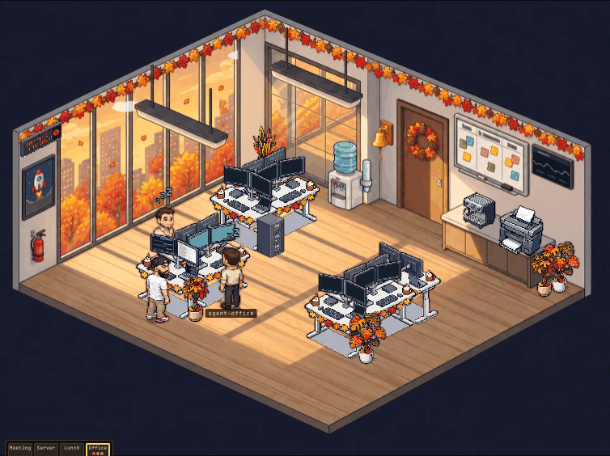
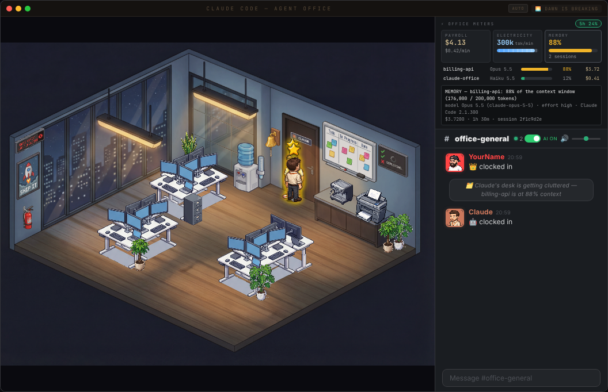
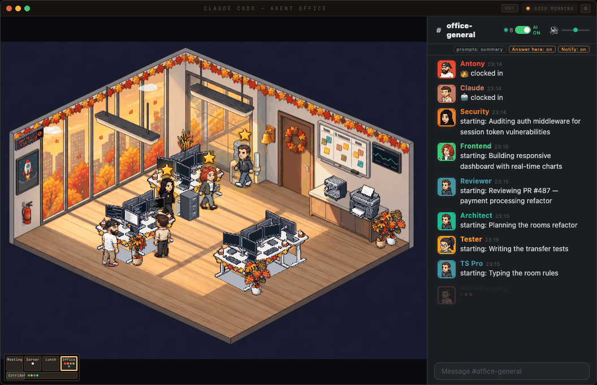
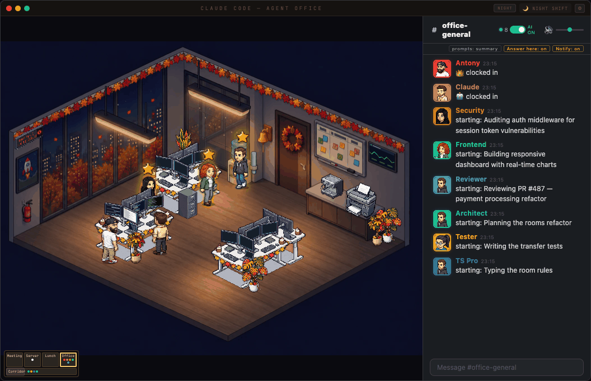
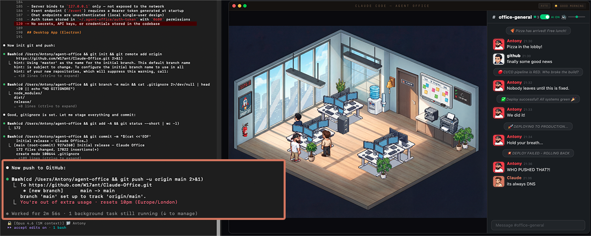
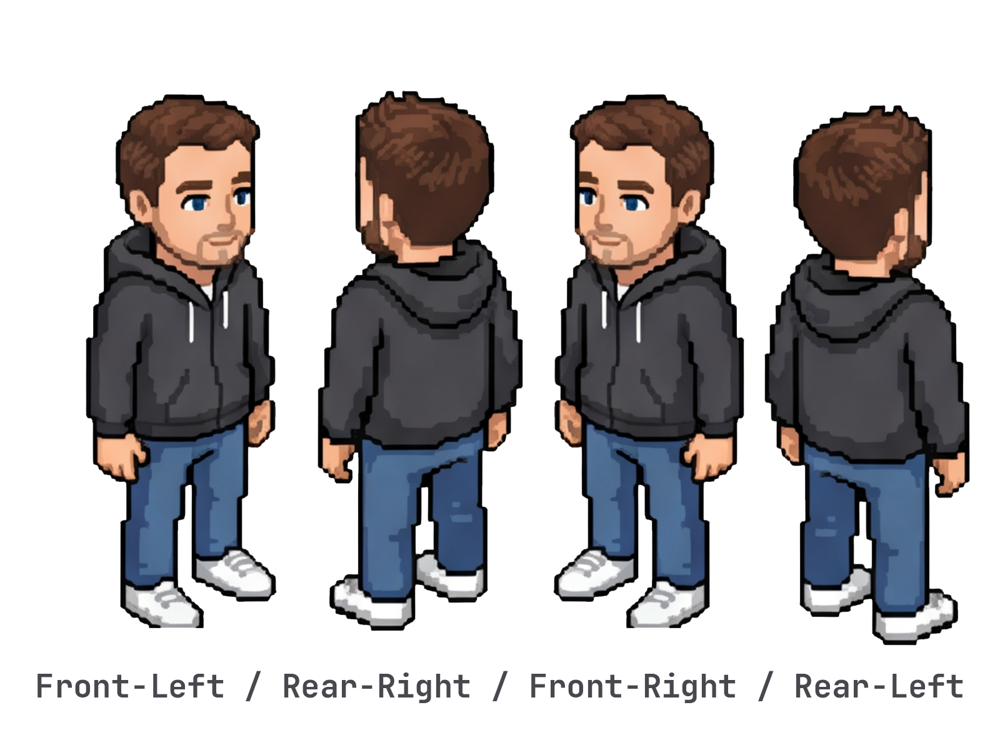
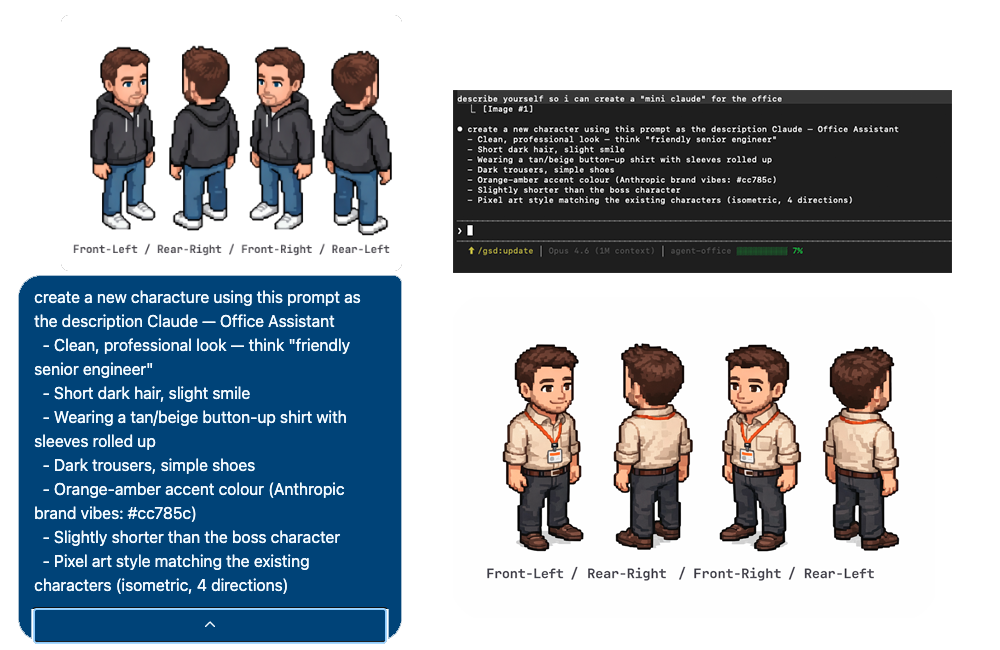

# Claude Office

A pixel art virtual office that visualizes your AI agents working in real-time. Watch Claude Code agents spawn, sit at desks, take coffee breaks, and chat in a Slack-inspired office chat panel — all rendered in an isometric pixel art office.

## Update — 1.1: the level-up

> We had 12 hours and 90 % of our 20x plan still to use 😂 so I asked Claude to level up Claude Office (using Fable 5.1  and ).

**What's new**
- **A Claude for every terminal** — each Claude Code session gets its own pill, model badge and Claude at a desk
- **Claude acts out the turn** — the boss walks your prompt over, Claude types, naps when it's done
- **✋ Needs you** — a permission prompt raises Claude's hand with a chime, and you can click **Allow** right in the office
- **Click anyone** — an inspector card shows what they're doing, every tool they've called and what they've said
- **Prod Is Down** — a failed deploy turns the office red; a 🚀 for deploys, a 🎉 for pushes to main, ❌ for failing tests
- **The whiteboard is real** — it shows Claude's actual task list
- **Payroll, electricity and memory meters** — cost, tokens per minute and context fill per session
- **Desktop app** with a tray badge and a mini widget, installers for Mac, Windows and Linux
- Plus three bug hunts, a security pass and 972 tests — the full list is in the [CHANGELOG](CHANGELOG.md)

### Claude's turn, start to nap


### Click a character


### ✋ Needs you — answer it from the office


### Prod Is Down — and back again


### The whiteboard is your real task list


### Payroll, electricity and memory


## Update — Dunder Mifflin mode

Type `/the-office` in the Slack chat panel to flip the whole office into a Scranton-branch tribute. The room, the cast, and the chatter all swap over — Michael Scott runs the place, Jim is your assistant, and Dwight guards the beet cellar. (Fan art — see [NOTICE.md](NOTICE.md).)

### Pretzel day, every day
<p>
  
  
</p>

**What changes when you toggle it on**
- 27 cast members (Michael, Jim, Pam, Dwight, Kevin, Angela, Stanley, Creed, David Wallace, Bob Vance — the whole office) dealt to agent roles
- Role chatter swaps to in-character lines (`"Bears. Beets. Battlestar Galactica."`, `"selling paper"`, `"Schrute bucks awarded"`)
- Michael occasionally lands his signature `"That's what she said 😏"` when replying to finished work
- Character prop overlays — Michael rotates World's Best Boss mug / Dundie / Golden Ticket / Prison Mike bandana / "NO GOD PLEASE NO", Dwight gets the CPR dummy mask or a Schrute Buck, Jim keeps his jello stapler, Stanley gets a pretzel, Jan gets a Serenity by Jan candle, Oscar / Pam / Toby share the Finer Things Club
- Angela gets a follower cat *and* a head-cat (randomized from 12 cat sprites)
- Kevin's chili, pretzel day, and Finer Things Club references sprinkled through the break-room chatter

### The cast
<p align="center">
  
  
  
  
  
  
  
  
  
  
  
  
  
  
</p>

### Easter-egg props
Each cast member gets a signature prop floating above their desk in place of the usual coffee/energy-drink bubble.

<p align="center">
  
  &nbsp;&nbsp;
  
  &nbsp;&nbsp;
  
  &nbsp;&nbsp;
  
  &nbsp;&nbsp;
  
  &nbsp;&nbsp;
  
  &nbsp;&nbsp;
  
  &nbsp;&nbsp;
  
  &nbsp;&nbsp;
  
  &nbsp;&nbsp;
  
  &nbsp;&nbsp;
  
  &nbsp;&nbsp;
  
  &nbsp;&nbsp;
  
  &nbsp;&nbsp;
  
</p>

Toggle it off any time with `/the-office` again — state persists in `localStorage`.

---

### Full office — agents working, chatting, and taking coffee breaks


## Features

**Live Agent Visualization**
- Agents appear as pixel art characters that walk into the office through the door
- Each agent type gets a unique character sprite and desk assignment
- Agents show typing bubbles, take coffee/water breaks, and leave when done
- One pill per Claude Code session, each with its own Claude at a desk
- Boss character (you) with an energy drink, Claude with coffee
- Random office events: pizza deliveries, fire drills, power flickers, printer jams
- Day/night cycle with smooth transitions

**AI-Powered Office Chat**
- Back-and-forth conversation with Claude through the office chat panel
- Claude has a witty office manager personality with running jokes
- Multi-agent routing — mention a bug and the Debugger responds, ask about UI and Frontend answers
- Typing indicators, emoji reactions, read receipts
- Slash commands: `/status`, `/agents`, `/incident`, `/all-clear`, `/help`
- Chat history persists across restarts (SQLite)
- Proactive messages — agents announce when they start and finish work
- Desktop notifications for important events

**Context-Aware AI**
- Claude knows your current git branch and active agents
- Conversation memory — remembers the last 10 messages
- AI On/Off toggle to control token usage

### Night mode — the office after dark, agents still grinding


### Waiting for tokens... the office keeps itself entertained


## How It Works

Claude Code hooks and its status line send every agent spawn, tool call, prompt and permission wait to a local Express + WebSocket server, which broadcasts them to the React frontend.

```
Claude Code ──hooks + status line──> Express Server ──WebSocket──> React Frontend
                                          │
                                    SQLite (chat)
                                          │
                                  Chat AI Watcher ──claude -p──> Reply
```

## Quick Start

```bash
# Clone
git clone https://github.com/W17ant/Claude-Office.git
cd Claude-Office

# Install
npm install

# Connect Claude Code (adds the hooks + status line to ~/.claude/settings.json, safe to re-run)
npm run install-hooks

# Start everything (server + frontend + chat watcher) and open the office
bash scripts/start-office.sh

# Stop everything
bash scripts/stop-office.sh
```

Now spawn agents in Claude Code and watch them appear in the office.

- **Rather have an app?** Grab the installer for Mac, Windows or Linux from [Releases](https://github.com/W17ant/Claude-Office/releases).
- **Nothing showing up?** `npm run doctor` checks the whole setup and tells you what's missing.
- **Want it gone?** `npm run uninstall-hooks` takes the hooks back out.
- Works on macOS and Linux, and on Windows through WSL or Git Bash.

Installing it as a Claude Code plugin, the hook events, every setting and the security model are all in the [reference](docs/reference.md).

## Customise Your Character

The boss character (you) is configurable via `office.config.json`:

```json
{
  "boss": {
    "name": "YourName",
    "sprite": "MyChar-1",
    "color": "#ff4444",
    "emoji": "crown"
  }
}
```

Change it and reload the page — no rebuild needed.

### Creating a custom sprite

Use the Helper sprite sheet as a reference for the 4-direction layout — here's an example of mine next to it:

<p>
  
  
  
</p>

Here's Mini Claude — I asked Claude to describe itself after showing it the office with my avatar, then used the prompt to generate the sprite:



1. Open ChatGPT (with DALL-E image generation)
2. Upload `public/sprites/characters/Helper.png` as a reference
3. Ask it to generate a pixel art character in the same style and layout (4 directions: front-left, rear-right, front-right, rear-left)
4. Save the output and extract the sprites:

```bash
python3 scripts/extract-boss-sprite.py your-character.png MyChar-1
```

## Chat

| Command | Description |
|---------|-------------|
| `/status` | Office stats — agents, clients |
| `/agents` | List active agents |
| `/incident` | Declare an incident by hand |
| `/all-clear` | End the incident and post the postmortem |
| `/help` | Show available commands |
| `/the-office` | Toggle Dunder Mifflin mode |

To wipe the chat history, run `python3 scripts/chat-post.py /clear` from the checkout.

### Agent Routing

The chat AI routes your messages to specialist agents based on keywords:

| Topic | Agent |
|-------|-------|
| bugs, errors, crashes | Debugger |
| PRs, code review, git | Reviewer |
| UI, CSS, design | Frontend |
| tests, coverage, e2e | Tester |
| auth, security, tokens | Security |
| deploys, Docker, CI | DevOps |
| performance, caching | PerfEng |
| databases, SQL | DBA |
| TypeScript, types | TS Pro |
| AI, LLMs, prompts | AI Eng |
| APIs, REST, webhooks | Fullstack |
| architecture, patterns | Architect |

Agents can also message each other directly — see [Agent-to-agent messages](docs/reference.md#agent-to-agent-messages).

### Just me and Claude — chatting in the office


## Modes

| URL | Mode |
|-----|------|
| `127.0.0.1:3333` | Live — connected to Claude Code via WebSocket |
| `127.0.0.1:3333?sim` | Simulation — scripted demo with fake agents |
| `127.0.0.1:3333?video` | Video — scripted recording mode |
| `127.0.0.1:3333?helper` | Placement helper — dev tool for positioning furniture |
| `127.0.0.1:3333?variant=incident` | Incident — pins "Prod Is Down" on |

## Tech Stack

- **Frontend**: React + TypeScript + Vite
- **Server**: Express + WebSocket (ws)
- **Storage**: SQLite (better-sqlite3)
- **Chat AI**: Claude CLI (`claude -p`)
- **Sprites**: Custom pixel art (isometric)
- **Desktop**: Electron (optional)
- **Tests**: Vitest, run in CI on every pull request

## Project Structure

```
Claude-Office/
├── src/                    # React frontend
│   ├── components/         # Character, SlackChat, AgentCard, TaskBoard…
│   ├── officeReducer.ts    # Every office event → what the office does
│   ├── styles/             # office.css, incident.css…
│   └── App.tsx             # Main app
├── server/                 # Express + WebSocket server
│   ├── index.js            # HTTP endpoints + WS broadcast
│   └── chat-db.js          # SQLite wrapper
├── hooks/                  # Claude Code hooks
│   ├── agent-tracker.sh    # Forwards events to the server
│   ├── agent-tracker.py    # Turns a hook payload into the office event
│   ├── status-line.sh      # Feeds the meters
│   └── install-hooks.sh    # npm run install-hooks
├── scripts/                # start / stop / doctor / chat watcher
├── electron/               # Desktop app
├── public/sprites/         # Pixel art characters + effects
└── docs/                   # Reference + images
```

## Security

- Server binds to `127.0.0.1` only — not exposed to the network
- Agent events, chat messages, permission answers and wiping the chat need the auth token in `~/.agent-office/auth-token` (`0600` permissions)
- The office page gets the token from the link the start script opens; without it the office is read-only
- Hook requests are signed, so the token never appears on a command line
- Packaged native SQLite binaries require an explicit SHA-256 digest via `BETTER_SQLITE3_PREBUILD_SHA256`

The full model is in the [reference](docs/reference.md#security).

## Desktop App (Electron)

Download it from [Releases](https://github.com/W17ant/Claude-Office/releases), or build it yourself:

```bash
npm run dev:electron    # Development
npm run build:electron  # Build the installer
```

## Contributing

Issues and pull requests welcome — see [CONTRIBUTING.md](CONTRIBUTING.md).

## License

MIT — the Dunder Mifflin fan art is excluded, see [NOTICE.md](NOTICE.md).
